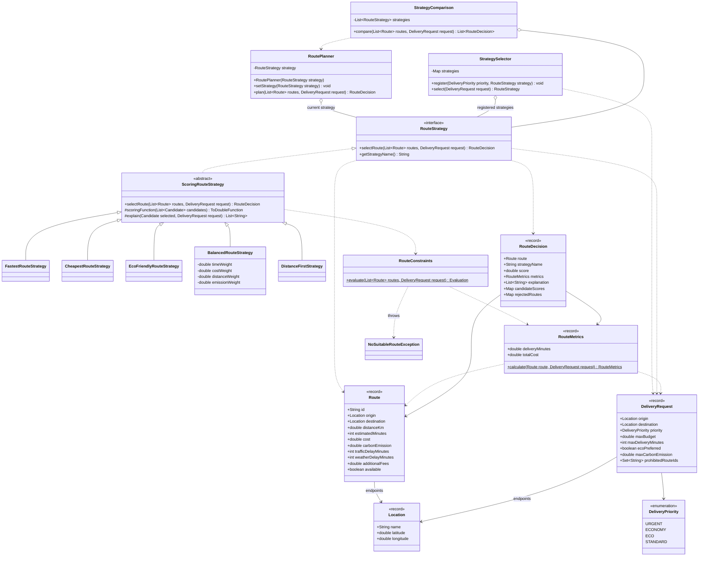
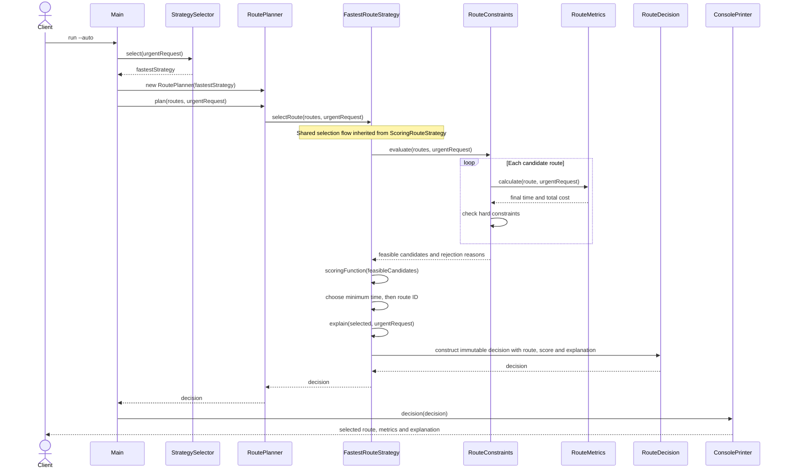

# UML diagrams

## Class diagram

## Sequence diagram

Successful urgent request from `Main.automaticSelection()`. The `selectRoute()` implementation is inherited from `ScoringRouteStrategy`; its calls to `scoringFunction()` and `explain()` dispatch to `FastestRouteStrategy`.

If no route is feasible, `RouteConstraints.evaluate()` throws `NoSuitableRouteException` before scoring. The failure demonstration catches it and prints the rejection reasons.
